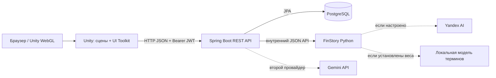
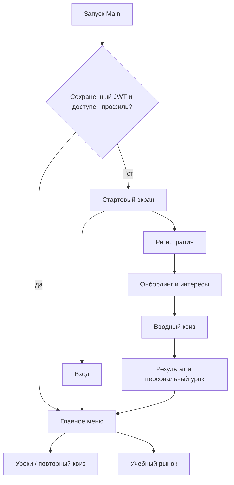

# Архитектура IVR Project

Документ описывает **реализованное в текущем коде**. Макеты дизайнера и `user_flow.jpg` задают направление интерфейса, но не являются описанием работающих функций.

## Общая схема

Unity отвечает за показ экранов, ввод и игровое взаимодействие. Spring отвечает за регистрацию, проверку ответов, очки, уроки и состояние рынка. PostgreSQL хранит долговременные данные. FinStory создаёт истории и объясняет термины, но не проверяет ответы и не начисляет награды. Исходные правила и правильные ответы задаёт проверенный серверный каталог.

## Репозитории и ключевые точки входа

| Часть | Код | Роль |
| --- | --- | --- |
| Unity | `Unity_WEB_A_IVR/Assets/Scenes/Main.unity`, `Quiz.unity` | Основное меню и отдельная сцена квиза |
| Навигация | `Unity_WEB_A_IVR/Assets/Scripts/UI/ScreenManager.cs`, `AppEntry.cs` | Переключение экранов и проверка сохранённой сессии |
| Интерфейс | `Unity_WEB_A_IVR/Assets/UI/Screens`, `Assets/Resources/UI/HubScreen.uxml`, `Assets/UI/Styles` | UXML/USS и обработчики UI Toolkit |
| HTTP | `Unity_WEB_A_IVR/Assets/Scripts/Api/ApiClient.cs`, `Services` | JSON-запросы, токен и обёртки API |
| Spring | `Kotlin_spring_project/src/main/kotlin/com/example/demo/DemoApplication.kt` | Запуск приложения |
| API | пакеты `auth`, `player`, `quiz`, `learning`, `market` | Контроллеры и бизнес-логика |
| FinStory | `FinStory_service/finstory` | Интересы, истории, термины и Yandex-интеграция |
| БД | `Kotlin_spring_project/compose.yaml`, JPA entities/repositories | Локальный PostgreSQL 16 и модель данных |

Зависимости: Unity 6000.4.6f1; Spring Boot 4.1.0, Kotlin 2.3.21, Java 21, PostgreSQL 16, Python 3.12. Подробные инструкции: [клиент](Unity_WEB_A_IVR/README.md), [сервер](Kotlin_spring_project/README.md), [FinStory](FinStory_service/README.md).

## Пользовательский сценарий

`AppEntry` инициализирует адрес API (по умолчанию `http://localhost:8080`) и проверяет профиль по сохранённому JWT. `ScreenManager` показывает Welcome, Login, Register, Onboarding и Hub в одной сцене `Main`. В Hub есть вкладки Home, Learn, Quests, Rating, Profile и Market. `GameManager` переносит конфигурацию квиза в сцену `Quiz`, а по завершении возвращает игрока в `Main`. Логика интерфейса вынесена в классы экранов; UXML/USS задают внешний вид.

## Аутентификация и безопасность

`POST /auth/register` создаёт игрока, `POST /auth/login` проверяет пароль. Пароли хэшируются BCrypt; сервер выдаёт JWT с `playerId` сроком на 7 дней. Unity хранит токен в `PlayerPrefs` и добавляет `Authorization: Bearer …` к запросам. Все остальные API требуют аутентификации. Сервер берёт идентификатор игрока из токена и проверяет владение попыткой/уроком. CORS сейчас разрешает все origin без cookies; перед публичным размещением список origin нужно ограничить. `PlayerPrefs` — практичное локальное хранение для прототипа, не защищённое хранилище браузера.

Контроллеры `/admin/players`, `/admin/market`, создание и удаление вопросов защищены ролью ADMIN. `JwtFilter` загружает актуальную роль игрока из БД при каждом запросе. Первый администратор назначается только из серверной конфигурации после регистрации аккаунта; публичного endpoint повышения роли нет.

## Персональное обучение

Серверный `LearningCatalog` содержит 4 темы и 16 заранее проверенных вопросов. Вводный тест берёт вопрос из каждой темы, обычный квиз — 5 вопросов из общего пула или 3 по теме. `POST /learning/attempts` создаёт попытку и отдаёт варианты без правильного индекса. `POST /learning/attempts/{id}/answers` фиксирует один ответ и возвращает объяснение. Повтор того же ответа допустим; изменение принятого ответа даёт 409. `POST /learning/attempts/{id}/finish` требует ответы на все вопросы, считает результат и начисляет по 10 очков только за впервые правильно решённый уникальный вопрос. Повторное завершение идемпотентно.

После завершения создаётся **один персональный урок по самой слабой теме попытки**. Проверенный разбор ошибок сразу хранится в БД. При настроенном `FINSTORY_URL` урок получает статус `PENDING`; фоновый worker передаёт FinStory тему, ошибки и категории интересов. Ответ со структурированной историей, героем, выводом и терминами получает статус `READY`, а при ошибке остаётся серверный разбор `FALLBACK`. Провайдеры упорядочены: FinStory, затем необязательный Gemini. Повторный квиз по `lessonId` сначала предлагает другие вопросы по теме; урок помечается завершённым при результате не ниже 50%. Детали: [PERSONAL_LEARNING.md](Kotlin_spring_project/PERSONAL_LEARNING.md).

Это **персонализация по истории ответов, теме и интересам**, а не дообучение модели на данных пользователя. Yandex вызывается только из FinStory; локальный fallback работает без внешнего API.

## Учебный рынок

Пакет `market` хранит акции, секторы, историю цен, новости, портфели, заявки и состояние симуляции. При пустой БД `MarketService` создаёт начальные данные. `MarketScheduler` проверяет необходимость шага каждые 60 секунд; администраторский API может поменять интервал или пропустить игровые дни. Клиент показывает котировки, новости, рейтинг и портфель и отправляет заявки BUY/SELL/SHORT/COVER через сервер. Это симуляция, не реальные банковские или биржевые операции.

## Данные PostgreSQL

| Сущность | Содержание |
| --- | --- |
| `Player`, `PlayerProgress` | Учётная запись, интересы, уровень и очки знаний |
| `LearningAttempt`, `PersonalLesson` | Снимок вопросов и ответов, результат, статус и текст индивидуального урока |
| `Question` | Отдельный каталог вопросов старого API `/questions` |
| `Stock`, `PricePoint`, `NewsEvent`, `MarketState` | Акции, цены, новости и часы игрового рынка |
| `Holding`, `MarketOrder` | Позиции и история действий игрока на рынке |

Локальный PostgreSQL использует Flyway и `spring.jpa.hibernate.ddl-auto=validate`. V1 описывает исходную схему, V2 добавляет роли. Существующая база принимается как baseline версии 1, а новая строится с нуля. Для быстрых тестов применяется H2 с `create-drop` и отключённым Flyway.

## Границы реализации и развитие

- Главное меню, регистрация, онбординг, серверный квиз, персональные уроки и учебный рынок имеют код и API; часть веток макета `user_flow.jpg` (магазин монет, все мини-игры и настройки) пока не покрыта такими же экранами и серверными сценариями.
- `POST /player/progress` оставлен для совместимости, но возвращает 409: очки считает только `/learning/attempts/{id}/finish`.
- Старый `/questions` и локальные вопросы Unity существуют отдельно от проверенного каталога `/learning`. Для персональных уроков основным является `/learning`.
- Интересы онбординга отправляются в FinStory через `MlClient`; при недоступности сервиса сохраняется категория `другое`. Текущий классификатор детерминированный и не обучает модель квиза.
- WebGL-сборку нужно создавать и проверять отдельно. Наличие кода Unity не означает, что опубликованная браузерная версия уже существует.
