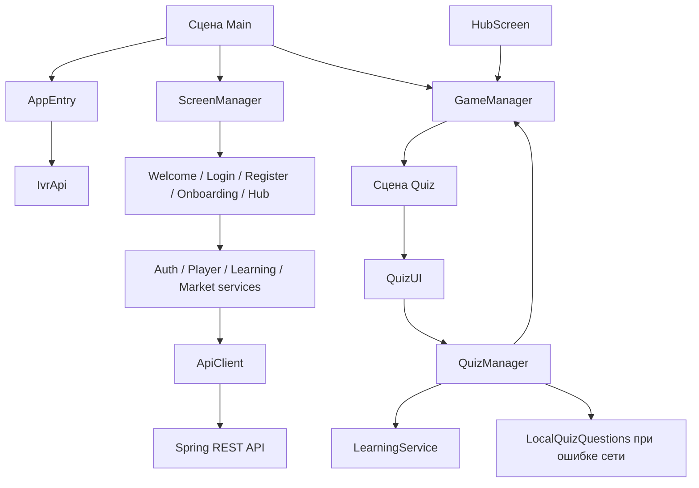

# Справочник по скриптам Unity

Документ разбирает пользовательские C#-файлы из `Assets/Scripts`, их ответственность и связи. Сгенерированный код из `Library` сюда не входит. Скрипты Unity Learn из `Assets/TutorialInfo` перечислены отдельно в конце.

## Как устроен клиент

В проекте есть три типа «контроллеров»:

- Unity `MonoBehaviour`: компоненты, которые Unity вызывает через `Awake`, `Start`, `OnDestroy` и которые привязываются к объектам сцены. Это `AppEntry`, `ScreenManager`, `GameManager`, `QuizManager`, `QuizUI` и несколько старых/тестовых компонентов.
- Обычные контроллеры интерфейса: `BaseScreen` и его экраны, а также `MarketPanel`. Они создаются `ScreenManager` и не висят на GameObject.
- Сервисы API: C#-классы без Unity lifecycle. Они строят HTTP-запросы и преобразуют JSON в модели.

Основной активный путь приложения: `AppEntry → IvrApi → ScreenManager → экран → сервис API`. Для квиза: `HubScreen → GameManager → Quiz scene → QuizUI → QuizManager → LearningService`.

## Точка входа и HTTP

### `Assets/Scripts/IvrApi.cs`

Статический фасад всех запросов к серверу. `Init(baseUrl)` берёт singleton `ApiClient` и создаёт `AuthService`, `PlayerService`, `QuestionService`, `LearningService` и `MarketService`. Остальной код обращается к ним как к `IvrApi.Auth`, `IvrApi.Player` и т. д. Инициализация должна произойти до первого запроса; в основном приложении её выполняет `AppEntry`.

### `Assets/Scripts/Api/ApiClient.cs`

Низкоуровневый HTTP-клиент и singleton. Хранит базовый URL и JWT, поддерживает GET/POST/PUT, сериализует тело через `JsonUtility`, добавляет Bearer-токен и ждёт `UnityWebRequest` без блокировки главного потока. Timeout — 20 секунд. Токен сохраняется под ключом `ivr_token` в `PlayerPrefs`, поэтому восстанавливается после перезапуска. Ошибка возвращается строкой вида `код: тело ответа`; исключения домена здесь не классифицируются.

### `Assets/Scripts/Api/ApiResult.cs`

Единый контейнер результата `ApiResult<T>`: `Success`, `Data`, `Error`. Фабрики `Ok` и `Fail` позволяют экрану обрабатывать успех и ошибку без исключений. Это не сетевой класс, а общий контракт между API-сервисами и UI.

## Сервисы API

### `Assets/Scripts/Api/Services/AuthService.cs`

Контролирует регистрацию, вход и выход. `Register` и `Login` отправляют DTO в `/auth/register` и `/auth/login`, разбирают `AuthResponse` и при успехе сохраняют JWT через `ApiClient.SetToken`. `Logout` удаляет токен. Связан с `RegisterScreen`, `LoginScreen`, `AppEntry` и `HubScreen`.

### `Assets/Scripts/Api/Services/PlayerService.cs`

Обёртка профиля игрока. `GetProfile` загружает `/player/profile`; `SetInterests` отправляет текст онбординга в `/player/interests`. `UpdateProgress` остался для совместимости со старым клиентом, но текущий сервер возвращает 409: очки теперь вычисляет `/learning/attempts/{id}/finish`. Новый код не должен использовать `UpdateProgress`.

### `Assets/Scripts/Api/Services/LearningService.cs`

Основной сервис квиза и персонального обучения:

- `Start` создаёт попытку;
- `Answer` фиксирует выбранный ответ;
- `Finish` завершает попытку и получает серверный результат;
- `Profile` получает прогресс по темам;
- `Lessons` получает персональные разборы.

`JsonUtility` не разбирает корневой JSON-массив, поэтому `Lessons` оборачивает его в объект `PersonalLessonList`.

### `Assets/Scripts/Api/Services/MarketService.cs`

HTTP-интерфейс учебного рынка. Загружает день симуляции, акции, историю, новости, портфель и рейтинг; `PlaceOrder` отправляет BUY/SELL/SHORT/COVER. Корневые массивы оборачиваются во вспомогательные wrapper-модели. Его используют `MarketPanel`, `HubScreen` и старые отдельные экраны рынка.

### `Assets/Scripts/Api/Services/QuestionService.cs`

Клиент старого API `/questions`: вопросы игрока, категории или урока. Текущий `QuizManager` уже использует `LearningService`, поэтому этот сервис не входит в основной поток персонального обучения. Его можно оставить для админского каталога или убрать после окончательной миграции.

## JSON-модели

Все модели помечены `[Serializable]` и используют публичные поля, потому что так работает Unity `JsonUtility`. Имена полей должны совпадать с JSON Spring.

### `Assets/Scripts/Models/AuthModels.cs`

`RegisterRequest`, `LoginRequest`, `AuthResponse`. Передают email, пароль, nickname; ответ содержит JWT и `playerId`.

### `Assets/Scripts/Models/PlayerModels.cs`

`PlayerProfile` хранит идентификатор, email, nickname, уровень, очки и интересы. `SetInterestsRequest` — тело онбординга. `UpdateProgressRequest` относится к устаревшему изменению очков.

### `Assets/Scripts/Models/QuizModels.cs`

`QuestionDto` — вопрос, варианты, индекс правильного ответа и старые поля category/level. В серверной попытке правильный индекс не должен использоваться до ответа; сервер возвращает его через `LearningAnswerDto`. `QuestionListWrapper` нужен для разбора JSON-массивов.

### `Assets/Scripts/Models/LearningModels.cs`

Модели полного жизненного цикла обучения: параметры старта, попытка, ответ, итог, персональный урок и профиль тем. `LearningEmptyRequest` позволяет отправить корректное пустое JSON-тело при завершении. `PersonalLessonList` — техническая обёртка массива.

### `Assets/Scripts/Models/MarketModels.cs`

DTO акций, точек истории, новостей, позиции, портфеля, заявки, состояния рынка и строки рейтинга. `StockListWrapper`, `PricePointListWrapper`, `NewsListWrapper`, `LeaderboardListWrapper` обходят ограничение `JsonUtility` на корневые массивы.

## Глобальное состояние и переходы между сценами

### `Assets/Scripts/Game/GameManager.cs`

Главный межсценовый контроллер. В `Awake` реализует singleton и вызывает `DontDestroyOnLoad`, поэтому переживает переход `Main → Quiz → Main`. Хранит профиль, конфигурацию запуска квиза и последний результат.

`StartQuiz` сохраняет `QuizConfig` и загружает сцену `Quiz`. `AcceptLearningResult` преобразует ответ сервера в `MiniGameResult`, запоминает ID персонального урока, локально отмечает обычный урок завершённым и возвращается в `Main`. `BackToMain` и `LoadGame` — общие переходы.

### `Assets/Scripts/Game/MiniGameResult.cs`

Небольшой неизменяемый объект результата: ID игры, начисленные очки и признак прохождения. Сейчас применяется для передачи результата квиза из сцены `Quiz` обратно в Hub. Поле `Score` получает `awardedScore` сервера, а не визуальные очки за все правильные ответы.

### `Assets/Scripts/Game/QuizConfig.cs`

Объект параметров будущего квиза. Фабрики создают:

- `Diagnostic` — вводный тест;
- `ForPersonalLesson` — повторение персонального разбора;
- `ForLesson` — тест по локальной карточке;
- `ForCategory` — старый режим категории;
- `Default` — общий квиз.

`GameManager.PendingQuiz` передаёт этот объект между сценами. Поле `Count` сейчас не отправляется серверу, а `Category` лишь влияет на заголовок: это остатки старой схемы.

## Квиз

### `Assets/Scripts/Game/QuizManager.cs`

Контроллер данных квиза на GameObject сцены `Quiz`. Он не рисует интерфейс.

`LoadFromServer` читает `GameManager.PendingQuiz`, вызывает `LearningService.Start` и сохраняет ID попытки. При ошибке переключается на `LocalQuizQuestions`; пустой `_attemptId` означает practice-режим. `Answer` проверяет локальный ответ либо отправляет его серверу. `_pendingAnswer` не позволяет заменить выбор при повторе после неопределённой сетевой ошибки. `Next` сдвигает индекс. `Finish` завершает серверную попытку и передаёт результат `GameManager`; в practice-режиме просто возвращается в `Main`.

Аргумент `finalScore` у `Finish` сейчас не используется: итог и награда считаются сервером.

### `Assets/Scripts/Game/QuizUI.cs`

Визуальный контроллер сцены `Quiz`; атрибут `RequireComponent` требует рядом `QuizManager`. В `Start` находит элементы UXML, назначает кнопки и запускает загрузку.

`ShowQuestion` заполняет вопрос и четыре кнопки. `OnAnswer` блокирует повторный клик, ждёт серверную проверку, подсвечивает правильный/ошибочный вариант и показывает объяснение. Локальные `_score` и `_correctCount` используются для мгновенного результата на экране. `ShowResults` показывает overlay; `OnContinue` просит `QuizManager.Finish` сохранить серверный результат. При сбое пользователь может повторить finish, не меняя ответы. Pause overlay позволяет вернуться в `Main`.

### `Assets/Scripts/Game/LocalQuizQuestions.cs`

Статический резерв вопросов по накоплениям, вкладам, страхованию и кредитам. Используется только когда серверную попытку создать не удалось. Эти результаты не начисляют очки и не создают персональный урок.

## Основное меню UI Toolkit

### `Assets/Scripts/UI/AppEntry.cs`

Главная точка запуска сцены `Main`. Вызывает `IvrApi.Init`, проверяет сохранённый токен через `GetProfile` и открывает Hub либо Welcome. При невалидной сессии удаляет токен. `baseUrl` задаётся в Inspector, по умолчанию `http://localhost:8080`.

### `Assets/Scripts/UI/BaseScreen.cs`

Базовый класс экранов UI Toolkit. Создаёт экземпляр `VisualTreeAsset`, растягивает его на контейнер, предоставляет `Show`, `Hide`, `SetStatus`. `InitializeCallbacks` вызывается после конструктора, чтобы производный класс успел инициализировать свои поля до регистрации событий.

### `Assets/Scripts/UI/ScreenManager.cs`

Верхнеуровневый контроллер экранов сцены `Main` и singleton. В `Awake` берёт корень `UIDocument`, загружает Hub из Resources, создаёт пять экранов и регистрирует callbacks. `Show` скрывает все экраны и показывает выбранный `AppScreen`. `ShowInterests` открывает последнюю страницу онбординга в режиме редактирования.

В `Start` он сначала показывает Welcome; затем асинхронный `AppEntry.Start` может переключить приложение в Hub. Это работает, но порядок двух `Start` не стоит использовать как бизнес-правило.

### `Assets/Scripts/UI/Screens/WelcomeScreen.cs`

Самый простой контроллер. Кнопка начала открывает Register, кнопка существующего аккаунта — Login. Сетевых запросов нет.

### `Assets/Scripts/UI/Screens/LoginScreen.cs`

Читает email/пароль из UXML, проверяет заполненность, блокирует кнопку на время запроса и вызывает `AuthService.Login`. При успехе показывает Hub, при ошибке выводит статус. Сам профиль после входа загружает `HubScreen.Show → RefreshProfile`.

### `Assets/Scripts/UI/Screens/RegisterScreen.cs`

Проверяет nickname, базовый формат email, длину пароля и совпадение повторного пароля. Затем вызывает `AuthService.Register`. При успехе открывает Onboarding. Кнопка блокируется до конца запроса через `try/finally`.

### `Assets/Scripts/UI/Screens/OnboardingScreen.cs`

Управляет пятью слайдами. Первые четыре объясняют игру, последний собирает интересы. `Confirm` вызывает `PlayerService.SetInterests`, обновляет профиль и запускает диагностический квиз. В режиме редактирования, открытом из профиля, после сохранения возвращает Hub без нового вводного теста.

### `Assets/Scripts/UI/Screens/HubScreen.cs`

Главный и самый крупный контроллер приложения. Управляет вкладками Home, Learn, Quests, Rating, Profile и Market.

- `Show` сбрасывает визуальное состояние, открывает Home, обновляет профиль и показывает результат предыдущего квиза.
- `Navigate` переключает секции и запускает нужную загрузку.
- `RefreshProfile` синхронизирует `GameManager.Profile`; 401 завершает сессию.
- `RenderHome`, `RenderProfile`, `RenderLessons` заполняют UXML.
- `RefreshPersonalLessons` параллельно загружает уроки и профиль знаний. Счётчик версии не позволяет старому async-ответу перерисовать экран после выхода.
- `OpenPersonalLesson` показывает объяснение, пример и шпаргалку.
- `RenderQuests` строит три клиентских квеста из профиля и локальных отметок уроков.
- `RefreshRating` строит подиум и список по капиталу.
- `RefreshPortfolio` показывает стоимость портфеля.
- `CloseResult` открывает только что созданный персональный разбор.
- `Logout` чистит токен и состояние.

Этот файл уже совмещает навигацию, загрузку данных и рендер нескольких разделов. При дальнейшем росте лучше вынести Learn, Quests, Rating и Profile в отдельные panel/controller-классы по образцу `MarketPanel`.

### `Assets/Scripts/UI/MarketPanel.cs`

Контроллер встроенной вкладки рынка. Это обычный C#-объект, который создаёт `HubScreen`. `Refresh` параллельно загружает состояние, акции, портфель и новости. Затем строит список акций, последние пять новостей и баланс. `SelectStock` показывает позицию, `Trade` блокирует четыре кнопки, отправляет заявку и обновляет портфель.

### `Assets/Scripts/UI/LessonCatalog.cs`

Локальный каталог четырёх базовых карточек: накопления, вклады, страхование, кредиты. `LessonDefinition` хранит заголовок и текст. `LessonCatalog` хранит список и локальные отметки выполнения в `PlayerPrefs` по ключу игрока и урока. Это отдельный слой от персональных уроков Spring: локальные отметки не синхронизируются между устройствами.

## Старые и вспомогательные UI-скрипты

### `Assets/Scripts/UI/LoginManager.cs`

Старый контроллер uGUI/TMP с панелями логина и профиля. Он дублирует новые `LoginScreen`, `RegisterScreen` и часть Hub. Компонент присутствует в `Main`, но сейчас `m_Enabled: 0`. Метод `AddScore` вызывает уже запрещённый `UpdateProgress`, поэтому включать этот компонент обратно без переработки не следует.

### `Assets/Scripts/Game/StockMarketUI.cs`

Старый самостоятельный контроллер рынка для отдельного `UIDocument`: строит акции и новости, выполняет сделки, пытается перейти в сцены `Leaderboard` и `Main`. В текущих сценах/префабах ссылки на этот компонент нет; основной рынок теперь встроен в Hub через `MarketPanel`.

### `Assets/Scripts/Game/LeaderboardUI.cs`

Старый самостоятельный экран рейтинга. Загружает leaderboard и строит строки с медалями. Не привязан к текущим сценам; аналогичная функциональность реализована внутри `HubScreen.RefreshRating`.

## Отладочные скрипты

### `Assets/Scripts/Tests/ApiTest.cs`

Автоматический smoke-тест API при `Start`: регистрация, вход, профиль, интересы и старый `UpdateProgress`. Скрипт сохранён для ручной разработки, но удалён из `Main.unity`, поэтому обычный запуск его не выполняет. Последняя проверка конфликтует с новым серверным правилом очков и требует обновления перед повторным использованием.

### `Assets/Scripts/Tests/TestUI.cs`

Debug-интерфейс через старый `OnGUI`: вход, регистрация, профиль, интересы, ручное добавление очков/уровня. Скрипт удалён из `Main.unity`; он повторно вызывает `IvrApi.Init` и использует запрещённый `UpdateProgress`. Это заготовка ручной проверки, не часть пользовательского меню.

## Скрипты Unity TutorialInfo

### `Assets/TutorialInfo/Scripts/Readme.cs`

Стандартный data asset стартового шаблона Unity для текста Readme в Editor. На игру и runtime не влияет.

### `Assets/TutorialInfo/Scripts/Editor/ReadmeEditor.cs`

Кастомный Inspector для `Readme.cs`. Находится в папке `Editor`, поэтому не попадает в runtime/WebGL. Это служебный код шаблона Unity, его можно удалить вместе с TutorialInfo, когда стартовая справка больше не нужна.

## Реальные привязки сцен

| Сцена | Активные пользовательские компоненты |
| --- | --- |
| `Main.unity` | `GameManager`, `AppEntry`, `ScreenManager`; API инициализирует только `AppEntry` |
| `Main.unity` | `LoginManager` присутствует, но отключён |
| `Quiz.unity` | `QuizManager`, `QuizUI` |

Обычные классы экранов, сервисов и моделей не обязаны иметь прямую ссылку в YAML сцены: их создают другие C#-классы.

## Что целесообразно улучшить дальше

1. При необходимости создать отдельную debug-сцену для `ApiTest` и `TestUI`; в обычной сцене их уже нет.
2. Удалить либо обновить `LoginManager`, `StockMarketUI`, `LeaderboardUI`, `QuestionService` и устаревший `UpdateProgress`, когда подтверждена полная миграция.
3. Разделить `HubScreen` на контроллеры вкладок; он уже отвечает за слишком много независимых экранов.
4. Перенести завершение базовых уроков из `PlayerPrefs` в Spring, если нужна синхронизация между браузерами и устройствами.
5. Добавить типизированные ошибки API и централизованную обработку 401/timeout вместо разбора строк в отдельных экранах.
