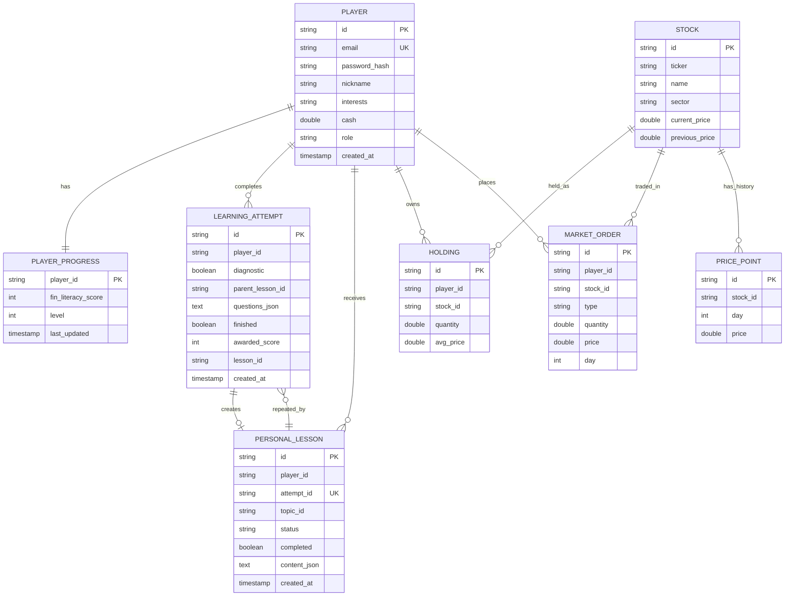
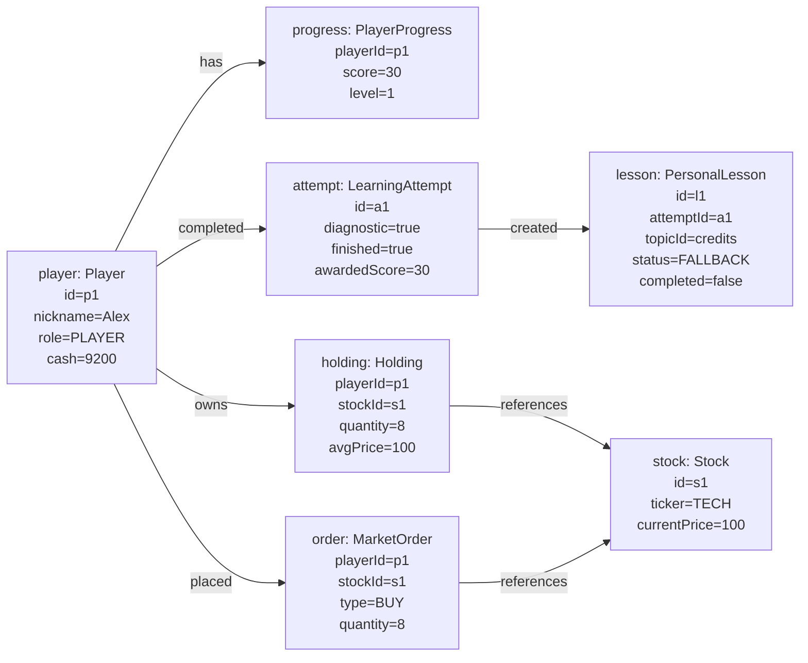

# Модель данных

## ER-диаграмма

Связи заданы идентификаторами, хотя в текущих JPA-сущностях не все оформлены внешними ключами на уровне аннотаций.

Дополнительные независимые сущности: `NEWS_EVENT` хранит новость игрового дня и влияние на сектор; `MARKET_STATE` — единственную строку с текущим днём и интервалом; `QUESTION` — старый административный каталог вопросов.

## Объектная диаграмма примера

Диаграмма показывает возможный снимок объектов после диагностического квиза и покупки акции. Значения демонстрационные.

