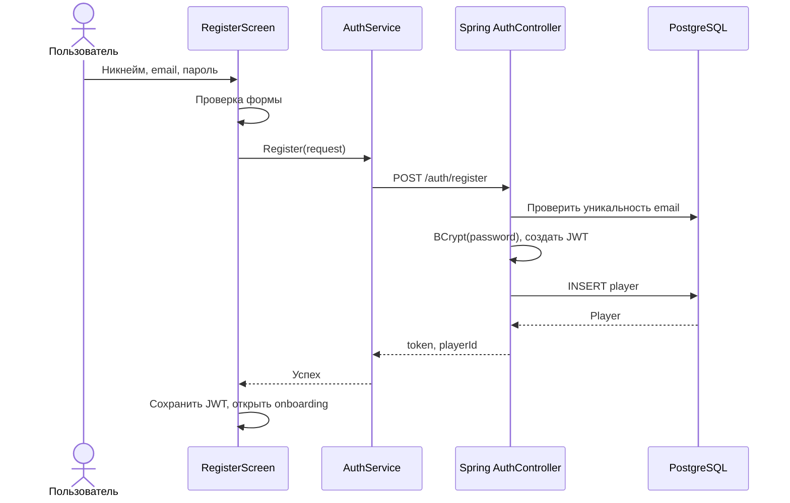
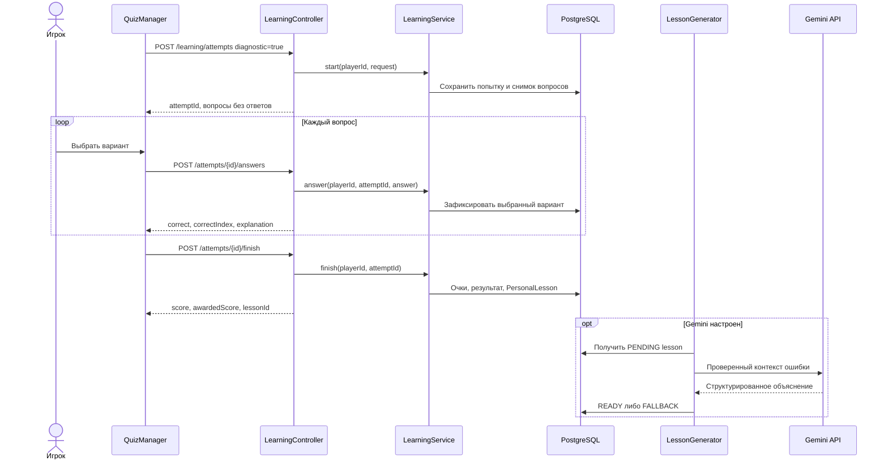
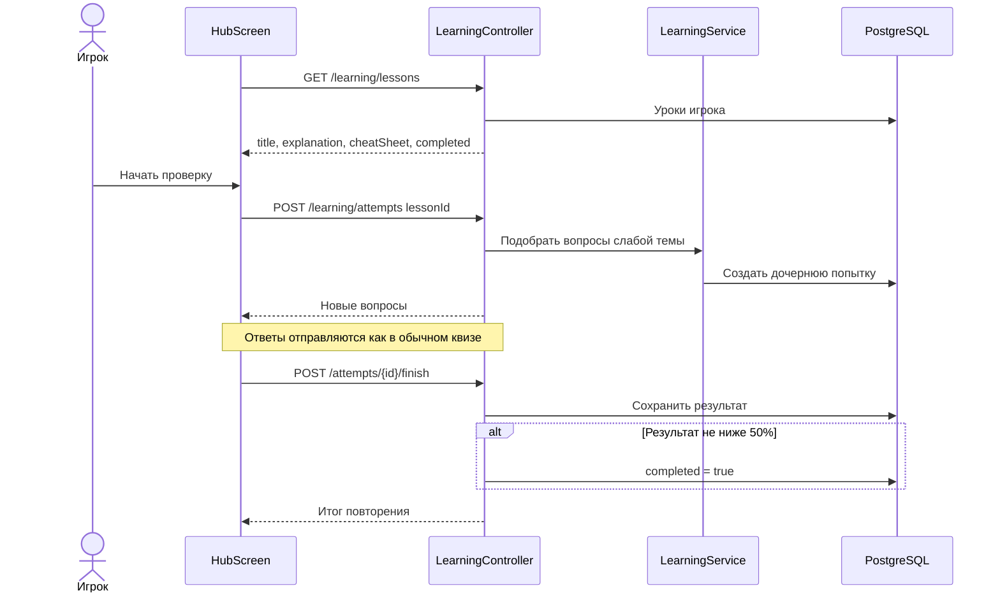
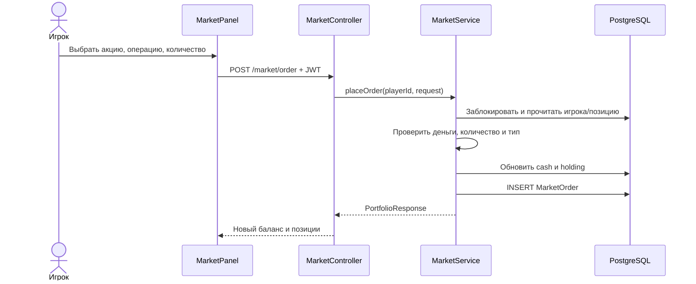
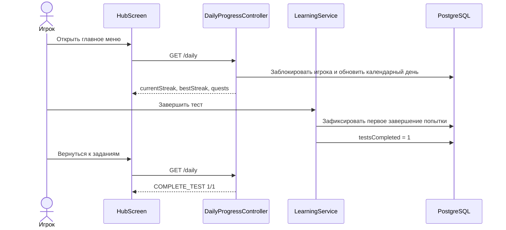

# Диаграммы последовательностей

## Регистрация и переход к онбордингу

## Диагностический квиз и персональный урок

## Повторный квиз

## Биржевая операция

## Ежедневная серия и задание за тест

