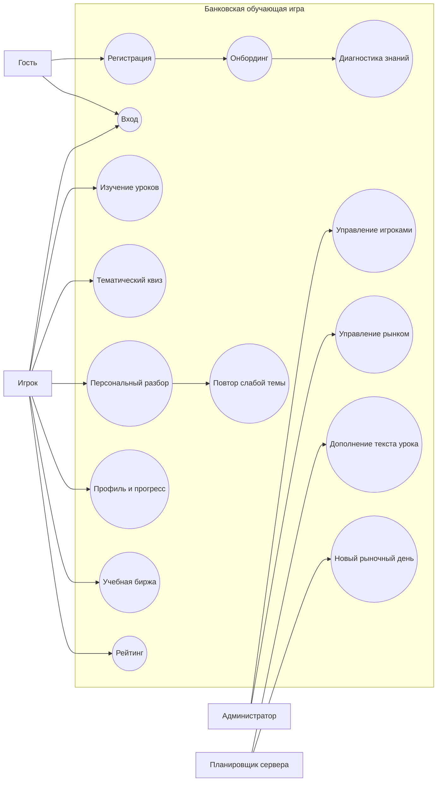

# Use Case: роли и функции

Администратор является зарегистрированным игроком с дополнительной ролью `ADMIN`. Gemini не является актором, принимающим решения: правильные ответы и слабая тема рассчитываются сервером, а внешняя модель может только дополнить текст уже созданного урока.
